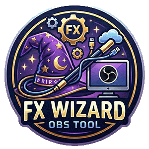

# FX Wizard: Live Graphics for OBS



**FX Wizard** puts animated lower thirds and fullscreen overlays on an OBS stream, run from a simple control panel in a web browser. The panel is built for touch screens, so a producer can take and clear graphics live with a tap.

---

## ✨ Features

### Lower thirds
- **10 animated backgrounds:** Blue, Green, Black, Red, Space, Clouds, Tech, Finance, Sports, Politics
- **6 font styles:** Default, Script, Fun, Modern, Classic, Accent
- **12 font colors:** White (default), Black, Silver, Gold, Yellow, Orange, Red, Pink, Purple, Blue, Sky, Green
- **9 screen positions:** any corner, any edge, or the center
- **6 animations:** Slide Up, Slide Down, Slide Left, Slide Right, Fade In, Spin
- **Set duration:** how many seconds it stays on screen

### Fullscreen overlays
Each overlay has its own built-in animation, so there's nothing extra to pick.

| Overlay | What it does | In | Out |
|---|---|---|---|
| **L3 Large** | Full-width name bar with an optional title | Slides in from the left | Slides back out to the left |
| **Color Wave** | Soft, color-changing glow around the edges; the center stays clear | Fades in | Fades out |
| **Confetti** | Bursts from both bottom corners, then light confetti rain | Slides up | Fades out |
| **Stinger** | A striped band sweeps from top-left to bottom-right (about 1.8 seconds) | Sweeps in | Sweeps off |
| **Fall** | Red, orange, gold and brown leaves sway, spin and flip as they float down | Fades in | Fades out |
| **Snow** | Soft white snowflakes drift down; nearer flakes are bigger and faster | Fades in | Fades out |

L3 Large text is always shown in capitals. If a name is longer than normal, it shrinks to fit instead of getting cut off.

### Import L3s
Turn plain `.txt` files into a list of L3 Large graphics, ready to take.
- One name per line, or `Name | Title` to add a title.
- Pick several files at once; they're added in file-name order.
- Each button shows the file it came from (for example **L3 1A**), which makes it easy to match a rundown.
- Imported L3s stay up for **5 minutes**, or until the producer clears them.
- Names already saved (same name and title) are skipped.

### Control panel
- **Two tabs:** Lower Third and Fullscreen Overlay. Each tab has its own saved list.
- **Saved graphics:** large, touch-friendly cards, two per row. Tap to take, tap ✕ to delete. A colored edge shows the background or overlay type.
- **Status line:** shows what you just took and how long it will stay up, for example **Taken: Ryan Fann** *for 5:00*.
- **Clear All:** takes everything off screen right away, with its normal out animation.

---

## 🔌 How It Works

```
Control panel  ──►  Server (port 8080)  ──►  Display page in OBS
(your browser)      (relays messages)       (shows the graphics)
```

- **Control panel:** `websocket_demo.html`, opened in any browser.
- **Display:** the same file with `#display` on the end, added to OBS as a Browser Source.
- **Server:** passes each message from the control panel to the display. It can run inside OBS (Python) or on its own (Node.js).

---

## 🛠️ Setup Option A: Server Inside OBS (Recommended)

_The server starts and stops with OBS automatically._

### 1. What you need
- **OBS Studio** with Python scripting
- **Python 3.11 (64-bit)**
- The `websockets` Python library

### 2. Install
1. **Install the library.** Open a terminal and run:
   ```bash
   python -m pip install websockets
   ```
2. **DLL fix.** In your Python install folder, copy `python311.dll` and rename the copy to `python3.dll`. This lets OBS load Python.
3. **Load the script.**
   - In OBS, go to **Tools > Scripts**.
   - On the **Python Settings** tab, set the path to your Python folder (for example `C:\Program Files\Python311`).
   - On the **Scripts** tab, click **+** and add `server.py`.
4. **Check it.** Open the control panel. The bar at the top should say **Connection Status: OPEN**.

---

## 🛠️ Setup Option B: Standalone Node.js Server

_Runs in its own window, separate from OBS._

### 1. What you need
- **Node.js**

### 2. Install
1. In a terminal in the project folder, run:
   ```bash
   npm install
   ```
2. Start the server:
   ```bash
   node server.js
   ```
   You can also double-click `launch_server.bat`. Open it in a text editor first and change the folder path to where FX Wizard is on your computer.

---

## 📺 Add the Display to OBS

1. Add a **Browser Source**.
2. Check **Local file** and choose `websocket_demo.html`.
3. Add `#display` to the end of the file path.
4. Set the size to your canvas, for example **1920 x 1080**. Fullscreen overlays are designed for 1920 x 1080.

---

## 💻 Using the Control Panel

Open `websocket_demo.html` in a browser (without `#display`). Check that the top bar says **OPEN**.

### Lower Third tab
1. Type a **Name** and an optional **Title**.
2. Set the **Duration** in seconds.
3. Pick a **Background**, **Font Style**, **Font Color**, **Location**, and **Animation**.
4. Press **⚡ TAKE** to put it on screen now, or **💾 SAVE** to add it to Saved Lower Thirds.

### Fullscreen Overlay tab
1. Pick an overlay: **L3 Large**, **Color Wave**, **Confetti**, **Stinger**, **Fall**, or **Snow**.
2. For L3 Large, type a **Name** and an optional **Title**.
3. Set the **Duration**. The Stinger has a fixed length, so this field is hidden for it.
4. Press **⚡ TAKE** or **💾 SAVE**.

### Importing L3s
1. Make a `.txt` file with one name per line:
   ```
   Jane Smith
   Marcus Lee
   Dr. Alicia Gomez | Keynote Speaker
   ```
2. On the Fullscreen Overlay tab, press **📄 IMPORT L3s (.txt)** and choose one or more files.
3. The names appear under **Saved Overlays**, each labeled with its file name.

### During the show
- **Tap a saved card** to take it.
- **✖ CLEAR ALL** removes everything from the screen.
- **✕** on a card deletes it (you'll be asked to confirm).

---

## 🎨 Customizing

| To change... | Look in | What to edit |
|---|---|---|
| Lower third text size | `css/styles.css`, section 4 | `font-size` in `#action-name` and `#action-title` |
| Add a lower third background | `css/styles.css`, section 5 | Add a class with your GIF from `assets/`, add a button in the **Backgrounds** part of `websocket_demo.html`, and add the name to `BG_CLASSES` in the script |
| L3 Large image | `assets/kamc.png` | Replace the image (1920 x 1080) |
| L3 Large font or size | `css/styles.css`, section 7 | `#overlay-box.kamc #overlay-text` and `#overlay-name` |
| Stinger size, speed, or colors | `css/styles.css`, section 7 | The `--stinger-...` settings at the top of `#stinger` |
| Imported L3 duration | `websocket_demo.html`, script section 1 | `IMPORT_DURATION` (in seconds) |
| Server address | `websocket_demo.html`, script section 1 | `SOCKET_URL` |

Both `styles.css` and the script in `websocket_demo.html` start with a numbered list of their sections.

---

## 📝 Good to Know

- **Saved graphics live in the browser.** They're stored on the computer and browser where you saved them. Clearing that browser's data deletes them, and a different computer or browser starts with an empty list.
- **Large GIFs load the first time.** Some backgrounds are 20–50 MB, so a background can take a moment to appear the first time it's used.
- **Older saves still work.** Graphics saved with earlier versions still open correctly.

---

## 📁 Project Files

| File | What it is |
|---|---|
| `websocket_demo.html` | The control panel and the display (one page) |
| `css/styles.css` | All the styles and animations |
| `assets/` | Background GIFs, the L3 Large image, and logos |
| `server.py` | Server that runs inside OBS |
| `server.js` | Standalone Node.js server |
| `launch_server.bat` | Double-click launcher for the Node.js server |

---

## 📜 License

This project is licensed under the MIT License. See the LICENSE file for details.

## 📧 Contact

For support, contact the author at **ryan.fann@gmail.com** or visit the GitHub repository: **FXWizard**

## 🌟 Acknowledgements

This project benefited from the assistance of Gemini, a large language model, in the following areas:

- **Architectural Design**: Transitioning to an internal Python WebSocket server for OBS.
- **UI Refinement**: Implementation of Tailwind CSS and studio-grade color palettes.
- **Debugging**: Resolving CSS animation conflicts and Python async loop errors.
- **Branding**: Generation of the FX Wizard Logo.
- **Gifs**: Used [EzGif](https://ezgif.com/video-to-gif) to transfer content from [Storyblocks](https://www.storyblocks.com/)
- **Fonts**: [Google Fonts](https://fonts.google.com/)
