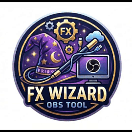
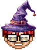

# FX Wizard: Live Graphics for OBS



**FX Wizard** puts animated lower thirds and fullscreen overlays on an OBS stream, run from a simple control panel in a web browser. The panel is built for touch screens, so a producer can take and clear graphics live with a tap.

---

## 📑 Index

- [Features](#-features)
- [How It Works](#-how-it-works)
- [Setup Option A: Server Inside OBS (Recommended)](#️-setup-option-a-server-inside-obs-recommended)
- [Setup Option B: Standalone Node.js Server](#️-setup-option-b-standalone-nodejs-server)
- [Add the Display to OBS](#-add-the-display-to-obs)
- [Open the Control Panel](#️-open-the-control-panel)
- [Greenscreen Depth](#-greenscreen-depth)
- [OBS Recommendations](#️-obs-recommendations)
- [Using the Control Panel](#-using-the-control-panel)
  - [Animated L3s tab](#animated-l3s-tab)
  - [Fullscreen Overlays tab](#fullscreen-overlays-tab)
  - [Importing L3s](#importing-l3s)
  - [Scene Builder](#scene-builder)
  - [Sound Pad](#sound-pad)
  - [Simple mode (themes)](#simple-mode-themes)
  - [Saving shows](#saving-shows)
  - [Running a show](#running-a-show)
  - [Saving rundowns](#saving-rundowns)
  - [Running the show](#running-the-show)
  - [Show timing](#show-timing)
    - [Stream Deck and hotkeys](#stream-deck-and-hotkeys)
  - [The projector (anchor view)](#the-projector-anchor-view)
  - [During the show](#during-the-show)
- [Customizing](#-customizing)
- [Advanced Customization](#-advanced-customization) (advanced users only)
- [Tests](#-tests)
- [Good to Know](#-good-to-know)
- [Project Files](#-project-files)
- [What's Next](#-whats-next)
- [License](#-license) · [Credits](#-credits) · [Contact Me](#-contact-me)

---

## ✨ Features

### Animated lower thirds
- **14 animated backgrounds:** Blue, Green, Black, Red, Space, Clouds, Fantasy, Code, Tech, Finance, Sports, Politics, Holiday, Café (looping WebM videos), plus **Custom** (an image you pick from the `custom` folder)
- **6 font styles:** Default, Script, Fun, Modern, Classic, Accent
- **12 font colors:** White (default), Black, Silver, Gold, Yellow, Orange, Red, Pink, Purple, Blue, Sky, Green
- **9 screen positions:** any corner, any edge, or the center
- **9 animations:** Slide Up, Slide Down, Slide Left, Slide Right, Fade In, Spin, **Glitch** (flickers in as torn, color-shifted slices, and glitches out the same way), **Bounce** (drops onto its spot and bounces), and **Slam** (comes down hard from big and blurry, with a flash and a shake). All of them except Glitch fade out
- **Set duration:** how many seconds it stays on screen
- **Easy to read:** a see-through black wash sits between the background and the text, and the title is set a little heavier
- **Slanted edge that faces the middle:** on the left or in the middle of the screen the box's slanted edge is on its right; on the right side (Top, Center or Bottom Right) it's on its left

### Fullscreen overlays
Each overlay has its own built-in animation, so there's nothing extra to pick.

| Overlay | What it does | In | Out |
|---|---|---|---|
| **Fullscreen L3s** | | | |
| **L3 PNG** | Full-width name bar (`assets/l3Large.png`) with an optional title | Slides in from the left | Slides back out to the left |
| **KAMC** | Like L3 PNG, on `assets/kamc.png`, with its own text: a bigger name, further left, with a softer shadow | Slides in from the left | Slides back out to the left |
| **L3 Info** | One paragraph of information on `assets/l3LargeAlt.png` in the bottom-left corner. The text is centered in the image's box and wraps onto about 5 lines (up to 400 characters). Line breaks you type are kept | Slides in from the left | Slides back out to the left |
| **L3 Gif** | Name and title on a bar showing `assets/largeGif.gif`, centered across the screen. Square corners, no side borders, and the GIF fades out at both sides | Rises up from the bottom | Drops back down |
| **Custom** | Like L3 Gif, with a PNG, JPG or GIF you pick from the `custom` folder | Rises up from the bottom | Drops back down |
| **Location** | A red map-pin tile and the place you type, top left, like a live report. The pin slides in from the right and the place from the left, crossing as they meet, and the pin gives a little bounce | Pin and place cross in | Slides back out to the left, as one block |
| **Overlays** | | | |
| **Color Wave** | Soft, color-changing glow around the edges; the center stays clear | Fades in | Fades out |
| **Confetti** | Bursts from both bottom corners, then light confetti rain | Slides up | Fades out |
| **Fall** | Red, orange, gold and brown leaves sway, spin and flip as they float down | Fades in | Fades out |
| **Snow** | Soft white snowflakes drift down; nearer flakes are bigger and faster | Fades in | Fades out |
| **Fire** | Flames burn along the bottom of the screen while glowing embers float up | Fades in | Fades out |
| **Rain** | Streaks of rain falling at a slight slant, small splashes where it lands near the bottom, and a cool mist | Fades in | Fades out |
| **Underwater** | Blue-green water with swaying light rays, rising bubbles, and small schools of fish swimming by every few seconds | Fades in | Fades out |
| **Arrested** | Police lights flash red and blue, then a steel jail cell door slams down over the screen with a shake (the wide gaps between the bars show the scene behind). It lifts away in the last second | Lights flash, door drops | Door lifts, fades out |
| **Hot Take** | The bottom of the screen catches fire, a flaming **HOT TAKE** badge slams in just above the flames (clear of the host's face) and its heat meter maxes out, with embers flying. Type your own text (for example *Unpopular Opinion*) or leave it blank | Slams in | Fades out |
| **Like & Subscribe** | **Like**, **Follow** and **Subscribe** buttons pop up along the bottom, a cursor clicks each one (they change to **Liked**, **Following** and **Subscribed**) and the bell rings, all in about 3 seconds. Any socials you add (YouTube, Facebook, Twitter, Instagram, LinkedIn, Web) show above the buttons, each with its icon | Pops up | Fades out |
| **Breaking News** | **LIVE** in the top-right corner and a red **BREAKING NEWS** bar along the bottom, with your ticker text scrolling across. Leave the ticker text empty and it scrolls **Breaking News \| Breaking News \| ...** | Bar slides up | Fades out |
| **St. Patrick's** | Shamrocks (now and then a lucky four-leaf clover) and spinning gold coins tumble down, the coins catching the light, with a soft green glow around the edges | Fades in | Fades out |
| **Comic** | **POW!**, **ZAP!**, **BAM!**, **KAPOW!** and more pop in one after another in spiky comic bursts around the edges of the screen (never over the middle), each with a jolt and a wobble, then shrink away. Red and blue halftone dots fill the corners | Fades in | Fades out |
| **Disco Ball** | A mirror ball drops down on its cord with a bounce and spins, its tiles glinting, while spots of colored light sweep around the screen, soft beams turn from it and the room dims a little | Drops in | Fades out |
| **V-Day** | Hearts in reds and pinks float up the screen, swaying and gently beating, with twinkling sparkles and a soft pink glow around the edges | Fades in | Fades out |
| **Retro VHS** | The picture looks like an old tape playing: scan lines, grain, a soft vignette, the ragged head-switching noise along the bottom, and a tracking glitch that rolls through now and then. The VCR's display shows **PLAY ▶** and **SP** at the top, the tape counter bottom left, and the date and time bottom right, like a camcorder | Fades in | Fades out |
| **Stingers** | | | |
| **Standard** | A wide band of red, white and blue stripes (some with stars) sweeps from top-left to bottom-right, covering the whole screen at the halfway point; the stripes drift slightly (about 2 seconds) | Sweeps in | Sweeps off |
| **Storm** | Storm clouds roll down with rain and lightning, cover the screen, then clear (about 2.8 seconds) | Rolls in | Clears |
| **Fire** | A wall of flame roars up from the bottom and fills the screen, with flames rising through it and sparks flying, then dies back down (about 2.4 seconds) | Roars up | Dies down |
| **Hearts** | Hearts pop in all over the screen over a rosy wash until it's full and a big heart beats in the middle, then they all float up and away (about 2.6 seconds) | Pops in | Floats away |
| **Ghost** | A big glowing ghost rises from the bottom and floats off the top (about 2.4 seconds) | Rises in | Floats off |
| **Color Bars** | TV color bars: each piece slides in from its own direction, they hold, then fade (about 2.6 seconds) | Slides in | Fades out |
| **Static** | An old TV screen full of static with a rolling band (about 1.8 seconds) | Fades in | Fades out |
| **Xmas** | A candy-cane band with a string of lights sweeps from left to right (about 1.8 seconds) | Sweeps in | Sweeps off |
| **Sports** | Pick a sport (about 2.6 seconds): **Football** (one giant football jets across the screen), **Basketball** (basketballs rain down and pile up until they cover the screen), **Baseball** (home plate spins in on a patch of dirt, with a puff of dust), or **Soccer** (a ball flies straight at the camera, thumps the lens, and bounces away) | Flies, rains or spins in | Leaves the same way |
| **Spring** | Flowers pop in a few at a time until they cover the screen, butterflies flutter past, then a breeze blows the flowers away (about 3 seconds) | Pops in | Blows away |
| **Fireworks** | Rockets streak up into a night sky that fills the screen and burst in color (round bursts, rings, drooping gold willows and crackling glitter). The biggest go off just before the halfway point, with a flash, then the sky fades as the last sparks fall (about 3 seconds) | Rockets go up | Sky fades |
| **8-Bit** | Chunky pixel blocks in rainbow bands stair-step across the screen like an old game console's screen wipe until it's covered, a pixel-art star hops in the middle with twinkles, then the blocks wipe away the same way (about 2.6 seconds) | Blocks step in | Blocks step out |
| **Cat** | Two paws grab the bottom edge of the screen, then a giant orange tabby's face rises up so big it fills the screen. It looks around, blinks and twitches its whiskers, then ducks back down and the paws let go (about 2.8 seconds) | Rises up | Ducks down |
| **Curtains** | Red velvet theater curtains sweep in from both sides under a scalloped valance with gold trim and meet in the middle, a warm spotlight glows on them, then they're pulled back to gold tie-backs at the sides like a stage reveal and slide away (about 3 seconds) | Close in | Pulled back |
| **Coffee** | A cup of coffee on its saucer, seen from above, slides in steaming and turning; the camera zooms into the foam while latte art draws itself, a heart around **Mom** (or your own words, typed in **Text (optional)**, up to 14 characters), until the foam fills the screen; then it zooms on through and fades away (about 3.4 seconds) | Slides in | Zooms through |
| **Medical** | Blue and white: blue panels sweep in from both sides as a white heartbeat line races across; at the middle a big white medical cross pulses as the heartbeat passes under it, then the panels sweep back out (about 2.4 seconds) | Sweeps in | Sweeps out |

| **Content** | | | |
| **Content** | A TV, almost full screen, showing a picture (PNG, JPG, GIF or WebP) or a video (MP4 or WebM) you pick from the `content` folder. The stream around it dims a little. A picture stays up 15 seconds; a video plays all the way through, once, with its sound (it starts as soon as the screen is on, and its Duration fills in with its length). A file that's gone from the folder shows **No signal** | The TV rises into place, then its screen powers on (a bright line opens out to the picture) | The screen powers off to a line, then a dot, and the TV drops away |
| **Content Full** | The same pictures and videos, filling the source with no TV (black at the sides of one that isn't 16:9). Pictures 15 seconds, videos all the way through | Dissolves in | Dissolves out |

📺 **Content has its own browser source:** Content and Content Full show on `fx_wizard.html#content`, not on `#display`, so they stay up while lower thirds, overlays and stingers come and go (and taking one of those never takes Content down). In OBS you can make it full screen in one scene and a smaller box beside the cameras in another. See [OBS Recommendations](#️-obs-recommendations).

L3 PNG, L3 Info, L3 Gif and Custom text is always shown in capitals. If text is longer than normal, it shrinks to fit instead of getting cut off.

🟩 **Greenscreen depth:** Color Wave, Confetti, Fall, Snow, Fire, Rain, Underwater, Arrested, Hot Take, V-Day and St. Patrick's each have a **Greenscreen** switch. With it on, they show partly *behind* you and partly *in front of* you. See [Greenscreen Depth](#-greenscreen-depth).

### Import L3s
Turn plain `.txt` files into a list of L3 graphics, ready to take. The Import button shows when **L3 PNG**, **KAMC** or **L3 Info** is selected, and the L3s are imported as that type.
- One name per line, or `Name | Title` to add a title. For **L3 Info**, each line is one paragraph.
- Pick several files at once; they're added in file-name order.
- Each button shows the file it came from (for example **L3 1A**), which makes it easy to match a rundown.
- Imported L3s go up as a **toggle**: they stay up until they're turned off, with **TOGGLE OFF**, or **OFF** on their card in the Podcast Rundown (where they show **TOGGLE** instead of a time). Ones imported before this work the same way.
- Names already saved (same name and title) are skipped.

### Control panel
- **Simple mode:** the **Pro / Simple** switch in the top bar (it reads **Pro** while off, **Simple** while on) swaps the tabs for one page in a theme's look (Classic, Sports, News, Tech & Gaming, Comedy, True Crime, Business, Lifestyle, Holiday): type a name and take it, and the theme's own overlays, stingers and sounds are one tap each. See [Simple mode](#simple-mode-themes).
- **Shows:** the chip on the left of the top bar names the show that's open (like **001 · Morning Show**), with an amber dot when something has changed since it was saved. Tap it to save the show, everything the panel is set to, as a numbered file in the `shows` folder, or to open another. See [Saving shows](#saving-shows).
- **Five tabs, as icons** (hover for the name): Animated L3s (a lower third), Fullscreen Overlays (sparkles), [Scene Builder](#scene-builder) (stacked bars), Podcast Rundown (a list) and [Sound Pad](#sound-pad) (a speaker). Animated L3s and Fullscreen Overlays each have their own saved list.
- **Sections that open and close:** the lower third options (Background, Font Style, Font Color, Location, Animation) and the overlay groups (Fullscreen L3s, Overlays, Stingers, Content) are big bars you tap to open or close. They all start closed, and opening one closes the others on that tab. On the Animated L3s tab, **▾ Expand all** (above the sections) opens them all at once; **▴ Collapse all** closes them, and closing any one ends it. Each bar has a chevron and shows what's picked inside. Lower thirds start on Blue, Default, White, Bottom Left and Slide Left; after that the panel remembers what's picked on each tab (and which tab was open).
- **Saved graphics:** large, touch-friendly cards, full width (or two per row with the switch on the left of the heading; the panel remembers). The list starts closed: tap the heading, or the chevron under it, to open or close it (each tab separately). Tap a card to take, ✕ to delete, ＋ to add it to the Podcast Rundown. A colored edge shows the background or overlay type. The trash can on the right of the heading deletes everything saved on that tab (it asks first). The spyglass next to the layout switch opens a search box that filters the list by name, title, file or style (Escape closes it).
- **Podcast Rundown:** the graphics you added with ＋, grouped into **blocks** (A to E to start; tap **+** next to the letters to add F, G and so on). Tap a letter under **Add to** to choose which block ＋ adds to.
  - **Labels:** each card is labeled on the left with its block, number and type: **A1-L3**, **A2-L3**... for lower thirds (animated or fullscreen) and **A1-OV**, **A2-OV**... for overlays and stingers. Lower thirds and overlays are numbered separately in each block, so a graphic in block B is **B1-L3**, **B1-OV** and so on.
  - Each card shows how long it stays on screen (for example **5s** or **5:00**) so you can double-check the rundown.
  - While **Set Show** is off: drag ⠿ to reorder or to move a card to another block, ✎ to edit the text, duration or block (and Greenscreen depth, for effects that support it) for this rundown only, and ✕ to remove. ✕ next to the last block removes it when it's empty. Cards can't be taken yet. While you're building it, the cards and buttons are a little smaller and thinner so more fits; once Set Show is on they're back to full size for touch.
  - **Collapsing sections** (while Set Show is off): tap the arrow on a section's header, or its name, to collapse it to just the header (blocks, the Tease, Open, Close and Unsorted all can), and again to open it. **◎** on a header collapses all the others, so you can work on one block. **▾ Expand all** / **▴ Collapse all** (above the rundown) opens or closes every section. Tapping a letter under **Add to** opens that block. Drag a card onto a collapsed section's header to move it to the end of that section. The panel remembers what's collapsed (it isn't part of a saved show), and once Set Show is on everything shows.
  - Turn on **Set Show** when the show is ready, then tap a card to take it. A red **LIVE SHOW** bar across the top shows the rundown is running, not being edited. While it's on, **Add to** becomes **ALL**: tap **ALL** to see the whole rundown, or a letter to see just that block. Empty blocks are greyed out.
  - While a card is on screen it's outlined in green, with a floating red **OFF** button that counts down the time left; tap it to take the graphic down early. A ★ marks the one played last.
  - **Tease, Open and Close:** sections with no letter of their own (no "Add to" letter either: drag things in, or pick them as the block with ✎). They aren't timed, and during the show each one is hidden while it's empty.
    - **Tease:** first of all, before the rest of the rundown (the Open and block A). It takes notes, scripts, scenes, one clip (the **T1-TEASE**) and one lower third (the **T-L3**). Tap the empty **T1-TEASE** slot to add the clip, and drag a lower third onto the **T-L3** slot. Scripts and scenes in it are numbered **T1-SCRIPT**, **T1-SCENE**... No overlays, SOTs, pictures or breaks.
    - **Open** (optional): after the Tease, before block A. It takes anything. Its items are numbered **OP1-L3**, **OP1-SCENE**...
    - **Close** (optional): the final section, after the last block. It takes anything, numbered **CL1-L3**, **CL1-SCENE**...
  - **Unsorted:** graphics added with **＋ RUNDOWN** (see below) wait at the bottom under **Unsorted**, labeled with just their type, until you drag them into a block (or move them with ✎). They aren't part of the show: they're hidden while Set Show is on, and turning it on tells you how many are left.
  - **Cues:** producer notes, placeholders for things that aren't graphics, the scene to take, and scripts. Tap **Note**, **Clip**, **SOT**, **PIC**, **Scene**, **Script** or **Break** (while Set Show is off), type the note, an optional description or the script (or load the script from a .txt file), and pick its block. Cues show as thin, greyed-out rows, numbered like graphics (**A1-CLIP**, **A2-CLIP**, **A1-SOT**, **A1-SCENE**, **B1-SCRIPT**...; notes have no number). Drag, edit and remove them like cards. Scripts show on the [projector](#the-projector-anchor-view); notes are for the crew and don't.
  - **Break:** a break you fire from the rundown. Pick its **break scene** (the OBS scene to go to for the break; it starts on the first of your [break scenes](#show-timing), if you've ticked any), give it a length (like 2:00) and, if you like, a name (*Break 1*). A Break can't be saved without a scene. It shows with an orange **BREAK** marker, its length and its scene (**BREAK 2:00 · Break Slate**). While **Set Show** is on, tap the marker (it has a ⚡) to fire it:
    - OBS switches to its break scene, the same as firing a TAKE (with OBS's current transition; it goes in the log). Going there doesn't start a second break, even if it's one of your break scenes. This needs server.py running in OBS; without it the break still starts, and the message box says the scene couldn't be taken. (A Break added before breaks had a scene says **no scene**: ✎ to pick one.)
    - It says so on the projector, big: **In break** and its countdown, and here in an orange strip with **End** to finish it early. It ends by itself when its time is up.
    - In **Advanced**, if the block it's in has a break in the show times, that break starts instead, the same as **Start Break** (with AKTA, if AKTA is on). Otherwise, with AKTA on, an AKTA break goes out with it and the return when it ends. With AKTA off (and always in Simple), it's just the break and its countdown.
    - Once fired, it's dimmed. **Start Break** from OBS fires the next one not fired yet (and takes its scene), and **Reset Break** ends the one that's on (or lets the last one fire again): see [Stream Deck](#stream-deck-and-hotkeys).
  - **Scene:** which shot to go to. Pick it from the list of scenes in OBS's active scene collection, or tap **Sources** to pick a source instead (a camera, say; audio-only sources are left out), and add a note if you like ("wide on the guest"). ↺ asks OBS again after you add or rename one. It shows in the rundown and on the projector with a yellow **TAKE** marker, so the director and whoever's on next know it's their turn. The list needs server.py running in OBS; without it (server.js, or not connected) you type the name instead. **Firing it:** while **Set Show** is on, tap the yellow **TAKE** (it gets a ⚡) and OBS switches to that scene, with its current transition (in Studio Mode it goes straight to program). It also becomes the current item, and goes in the log. The TAKE that's on program in OBS right now has a green ring, whoever switched it. Firing needs server.py running in OBS; a TAKE that names a source is a cue only and doesn't fire. If the scene is one of your [break scenes](#show-timing), it starts the break the same as switching to it in OBS would. The copy button on a TAKE (while Set Show is off) duplicates it right under it, for going back to the same shot.
  - **Block times:** tap **Set time** on a block's header to give it a planned length (like 6:00); the header also shows the total time of its graphics and when the block is due on air. The planned show length (with the breaks) and the graphics' total sit above the blocks. During the show, the block on air counts down its time left and turns red when it runs over. See [Show timing](#show-timing).
  - **Show timing** (from the OBS Show Timer): the show's start and end times of day, a break after any block, and a timing strip that stays at the top: the clock (red on air), the time left in the block or break on now, **Start Break**, the time to the show's end, and how far over or under the show will run, with **Update** and **÷** to fix it. Breaks can also start from OBS (break scenes and hotkeys) and send AKTA break and return cues. See [Show timing](#show-timing).
  - The trash can empties the rundown (saved graphics aren't affected, and the blocks stay). **CLEAR ALL** floats at the bottom, as on every tab.
  - **Save Rundown / Import Rundown** (shown while Set Show is off): save the whole rundown, its blocks and a full copy of every graphic, as a file in the `rundowns` folder, and bring it back later, like a template. It still works after those graphics are deleted from Saved, and the files can be copied to another computer. See [Saving rundowns](#saving-rundowns).
- **Duration:** on the right, just above the buttons. Picking an overlay fills in its usual time (for example Snow 15s, Breaking News 30s, Hot Take 7s), which you can still change. The Animated L3s tab keeps whatever you set there. For stingers it shows their fixed length, locked (with a padlock). The stinger buttons show their lengths too, for example **Storm · 2.8s**.
- **Buttons, two by two:** **TAKE** and **TOGGLE ON** on top, **SAVE** and **＋ RUNDOWN** below. **＋ RUNDOWN** puts what you've set up straight into the Podcast Rundown under **Unsorted**, without saving it first. It only works while Set Show is off; if it's on, it offers to turn it off (or cancel).
- **TOGGLE ON / TOGGLE OFF:** puts the graphic up with no time limit. The button turns yellow and pulses and reads **TOGGLE OFF** until you press it again, press Clear All, or take something else on the same tab. Stingers play once, so it's greyed out for them.
- **Message box:** floats at the bottom of the panel on every tab and shows what you just took and how long it will stay up, for example **Taken: Fire** *for 12s*. Then it counts down (*11s left*, *10s left*...) while the graphic is on screen, and says **Off screen: Fire** when it's gone. Any newer message (taking something else, Clear All, OFF, TOGGLE) takes its place. It lights up for each new message (and stays lit while it counts down), dims after 3 seconds, and goes back to a small, faint **Ready** after 15 seconds with nothing new. The panel leaves room at the bottom so it never covers the last card.
- **Clear All:** takes everything off screen right away, with its normal out animation. It floats at the very bottom of the panel, under the message box, on every tab and in Simple mode, so it's always one tap away without scrolling.
- **Greenscreen:** on the overlays that support [Greenscreen Depth](#-greenscreen-depth), a **Greenscreen** switch sits left of Duration. Each effect remembers its own.
- **Light mode** (the switch under the connection status): shows a moon in dark mode and a sun in light mode. Dark is the default, and the browser remembers your choice.
- **Connection help:** the wrench in the top bar opens a window with the live connection status and a list of things to check when it isn't **OPEN**.
- **Tiny logo:** tap the logo on the right of the connection bar to reload the panel (during a show it asks first; nothing on screen changes, and the rundown and log are kept).

---

## 🔌 How It Works

```
Control panel  ──►  Server (port 8080)  ──►  Display page in OBS
(your browser)      (relays messages)       (shows the graphics)
```

- **Control panel:** `fx_wizard.html`, opened in any browser. An OBS dock is recommended (see [Open the Control Panel](#️-open-the-control-panel)).
- **Display:** the same file with `#display` on the end, added to OBS as a Browser Source.
- **Underlay** (optional, for Greenscreen): the same file with `#underlay` on the end, added to OBS *below* your keyed camera.
- **Content** (for Content and Content Full): the same file with `#content` on the end, added to OBS below the display. It shows only the pictures and videos from the `content` folder, so they stay up while graphics come and go on the display.
- **Projector** (optional): the same file with `#projector` on the end, opened in a browser on a screen the anchor and guests can see.
- **Server:** passes each message from the control panel to the display. It can run inside OBS (Python) or on its own (Node.js).

---

## 🛠️ Setup Option A: Server Inside OBS (Recommended)

_The server starts and stops with OBS automatically._

### 1. What you need
- **OBS Studio** with Python scripting
- **Python 3.11 (64-bit)**
- The `websockets` Python library

### 2. Install
1. **Install the library.** Open a terminal and run:
   ```bash
   python -m pip install websockets
   ```
2. **DLL fix.** In your Python install folder, copy `python311.dll` and rename the copy to `python3.dll`. This lets OBS load Python.
3. **Load the script.**
   - In OBS, go to **Tools > Scripts**.
   - On the **Python Settings** tab, set the path to your Python folder (for example `C:\Program Files\Python311`).
   - On the **Scripts** tab, click **+** and add `server.py`.
4. **Check it.** Open the control panel. The bar at the top should say **Connection Status: OPEN**.

---

## 🛠️ Setup Option B: Standalone Node.js Server

_Runs in its own window, separate from OBS._

### 1. What you need
- **Node.js**

### 2. Install
1. In a terminal in the project folder, run:
   ```bash
   npm install
   ```
2. Start the server:
   ```bash
   node server.js
   ```
   You can also double-click `launch_server.bat`. Open it in a text editor first and change the folder path to where FX Wizard is on your computer.

---

## 📺 Add the Display to OBS

1. Add a **Browser Source**.
2. Check **Local file** and choose `fx_wizard.html`.
3. Add `#display` to the end of the file path.
4. Set the size to your canvas, for example **1920 x 1080**. Fullscreen overlays are designed for 1920 x 1080.
5. For **Content** (pictures and videos from the `content` folder), add a second Browser Source the same way, with `#content` on the end instead, **below** the `#display` one. Turn on **Control audio via OBS** on it so a video's sound goes out.

Using FX Wizard in more than one scene, or with a greenscreen? See [OBS Recommendations](#️-obs-recommendations) for the setup we use.

---

## 🖥️ Open the Control Panel

The control panel works in any browser, so it doesn't have to be an OBS dock, but a dock is **highly recommended**: it sits right next to your scenes and starts with OBS.

1. In OBS, open **Docks > Custom Browser Docks…** (on older versions, **View > Docks > Custom Browser Docks…**).
2. Name it **FX Wizard** and paste the path to the file as the URL, for example `file:///C:/FXWizard/fx_wizard.html` (no `#display` on the end).
3. Click **Apply**, then drag the dock where you want it.

👆 FX Wizard is built for a **touchscreen**: big buttons, sections you tap open, and drag-and-drop in the rundown. A touchscreen monitor next to OBS gives the smoothest experience, though a mouse works too.

---

## 🟩 Greenscreen Depth

If you key yourself out of a greenscreen in OBS, FX Wizard can put some of an overlay **behind** you and some **in front of** you, for a deeper, 3D look. Snow falls behind you *and* past the camera; fish swim behind your head and across your face.

### Set it up in OBS
1. Add another **Browser Source** with `fx_wizard.html#underlay` (same size as your canvas).
2. Order your sources (top of the list = front):
   ```
   fx_wizard.html#display    ← in front of you
   Your camera (with Chroma Key)
   fx_wizard.html#underlay   ← behind you
   Your background
   ```
3. In the control panel, pick one of the effects below on the Fullscreen Overlays tab and turn on its **Greenscreen** switch (left of Duration).

### What goes where
| Overlay | Behind you (`#underlay`) | In front of you (`#display`) |
|---|---|---|
| **Snow** | Small, far-away flakes | Bigger, closer flakes, plus a few big soft ones drifting right past the camera |
| **Fall** | Small, far-away leaves | Bigger leaves, plus a few big blurry ones close to the camera |
| **Confetti** | Smaller, slower confetti rain | The corner bursts and full-size confetti |
| **Fire** | The flames and their glow | Big embers drifting up, and a faint warm glow lighting you from below |
| **Underwater** | Deep water, light rays, ripples, far fish and small bubbles | A light blue tint (so you look underwater too), big bubbles, and close fish swimming past |
| **Color Wave** | The whole colored glow, like a backlight | Nothing |
| **Arrested** | The flashing red and blue lights | The jail cell door, with the lights catching its top (so you're behind bars) |
| **Hot Take** | The flames and the heat glow | The badge and its heat meter, and the embers |
| **Rain** | The far, fine rain and the mist | The near, heavier streaks and the splashes |
| **V-Day** | Small, far-away hearts | Bigger hearts, a few big blurry ones right past the camera, the sparkles and the pink glow |
| **St. Patrick's** | Small, far-away shamrocks and coins | Bigger shamrocks and coins, a few big blurry shamrocks right past the camera, and the green glow |

Everything else (lower thirds, the Fullscreen L3s, Breaking News, Retro VHS, and all the stingers) has no Greenscreen switch and stays on `#display` in front, as usual. When nothing on screen uses Greenscreen, the underlay stays empty, so you can leave it in your scene.

### Each effect has its own switch
The **Greenscreen** switch only shows on the eight effects above, and each one remembers its own setting: Snow can be on while Confetti stays off. Taking an effect uses its switch, and the message box says **Greenscreen** when it's on.

**SAVE** and **＋ RUNDOWN** keep the setting with the graphic, and its card shows a small green mark. Saved cards and Podcast Rundown cards always play the way they were saved. To change a rundown card, tick or untick **Greenscreen depth** with ✎.

---

## 🎛️ OBS Recommendations

Every OBS setup is a little different, but this one works well, especially with one or more greenscreen shots.

### Put FX Wizard in nested scenes
In OBS, a scene can be added to another scene like any other source. Make these scenes that hold nothing but FX Wizard:

1. **FX Display:** one Browser Source with `fx_wizard.html#display`, full screen (1920 x 1080).
2. **FX Content** (for Content and Content Full): one Browser Source with `fx_wizard.html#content`, full screen.
3. **FX Underlay** (only needed with a greenscreen): one Browser Source with `fx_wizard.html#underlay`, full screen.

Then, in each of your show scenes:

- **FX Display goes on top** in every scene where graphics should appear. The only things above it should be what's meant to cover everything, like a closer or a full-screen bumper (OBS transitions and stingers already play over the whole scene).
- **FX Content goes just below FX Display**, so lower thirds and overlays play over the pictures and videos. Put it above the cameras in a scene where Content fills the screen.
- **FX Underlay goes behind your keyed camera.** Put it just above the background and below the camera (or shot) that's keyed over that background. With several greenscreen cameras in one scene, put it below all of them.

```
Closer / full-screen bumper (if any)
FX Display          ← nested scene, on top
FX Content          ← nested scene: the pictures and videos, under the graphics
Camera 2 (Chroma Key)
Camera 1 (Chroma Key)
FX Underlay         ← nested scene, behind the people
Background
```

### Content beside the cameras
Content stays up on its own layer while lower thirds and overlays come and go, so it can share a scene with the cameras. In a scene where it should sit to the side (say the host on the left and the picture on the right), select **FX Content** in that scene and drag its corners, or right-click it and use **Transform > Edit Transform**, to make it the box you want. Each show scene keeps its own size and spot for it, so one scene can have it full screen and another a box on the right, and the same picture stays up when you switch between them. **Content Full** fills whatever box you give it, so it's the one to use there; **Content** (the TV) is made to fill the screen.

### Why nested scenes
- **One copy of each page, shared by every scene.** OBS runs a separate browser for every Browser Source, even in scenes that aren't on screen, and the animated effects take real work to draw. Nesting means one page each, so they're always in step: a graphic that's up stays up when you change scenes.
- **Change it once.** Resize, crop or move FX Display, FX Content or FX Underlay in its own scene, and every show scene follows. (To change it in just one show scene, like Content in a box beside the cameras, transform it in that scene instead.)
- **The layering is always right.** Graphics stay on top, and the behind-you effects stay behind the people, even in a scene with several greenscreen shots.

### Browser Source settings
- **Width 1920, Height 1080** (or your canvas size).
- Turn **off** *Shutdown source when not visible* and *Refresh browser when scene becomes active*, so graphics don't reset or vanish when you change scenes.
- Optional: turn on *Use custom frame rate* and set **60** for smoother effects (this uses a little more of the computer).
- Keep **Enable Browser Source Hardware Acceleration** on (OBS **Settings → Advanced → Sources**; it's on unless someone turned it off). In the [tests](#-tests), every effect ran at 55 to 60 frames a second with it, even on a basic Intel graphics chip. Without it, the effects now average under 16 ms a frame (60 fps) after the 2026-10-22 fixes, but a few still have short busier moments.
- For the [Sound Pad](#sound-pad): turn on **Control audio via OBS** on the FX Display source (not on FX Underlay), so its sounds show in the Audio Mixer and go out on the stream and recording.
- For a Content video's sound: turn on **Control audio via OBS** on the FX Content source too. It shows in the Audio Mixer as its own channel, so you can set its level apart from the Sound Pad.

---

## 💻 Using the Control Panel

Open `fx_wizard.html` in a browser (without `#display`). Check that the top bar says **OPEN**.

### Animated L3s tab
1. Type a **Name** and an optional **Title**.
2. Set the **Duration** in seconds (just above the buttons).
3. Tap a section to open it and pick a **Background**, **Font Style**, **Font Color**, **Location**, or **Animation**.
   - **Custom background:** put your images (PNG, JPG or GIF) in the `custom` folder next to `assets`, then tap **Custom…**. A window shows every image in the folder with a preview: tap the one to use (the one in use is outlined). The panel remembers it; until you pick one, or if it's taken out of the folder, the first image by file name is used. **Choose a file…** in the window picks it by hand instead (for an older server that can't list the folder); pick it from the `custom` folder, because that's where the display looks.
4. Press **TAKE** to put it on screen now, **TOGGLE ON** to keep it up until you turn it off, **SAVE** to add it to Saved L3s, or **＋ RUNDOWN** to put it straight into the Podcast Rundown (under Unsorted).

### Fullscreen Overlays tab
1. Open **Fullscreen L3s**, **Overlays**, **Stingers** or **Content** and pick one (opening one closes the others).
2. For L3 PNG, L3 Gif and Custom, type a **Name** and an optional **Title**. For L3 Info, type the paragraph in **Text**.
   - **Custom:** same as the Custom background: tap **Custom…** and pick the image from the `custom` folder.
   - **Like & Subscribe:** under **Socials**, tap an icon (YouTube, Facebook, Twitter, Instagram, LinkedIn, Web) to open a box for that account and type it in. Tap the icon again to leave it out. All of them are optional, and the panel remembers what you typed. Give it at least 4 seconds so the clicks finish.
   - **Hot Take:** type your own text in **Text (optional)**, or leave it blank for **HOT TAKE**.
   - **Coffee:** type the word for the foam in **Text (optional)** (*Dad*, *Grandma*, your show's name; up to 14 characters, longer words get smaller to fit the heart), or leave it blank for **Mom**.
   - **Breaking News:** type the scrolling text in **Ticker text**, or leave it empty for **Breaking News | Breaking News | ...**. **TOGGLE ON** keeps it up until you turn it off.
   - **Location:** type the place (like *City Hall*).
   - **Sports** (a stinger): pick **Football**, **Basketball**, **Baseball** or **Soccer** under **Sport**.
   - **Content** and **Content Full** (in their own section, **Content**): put pictures (PNG, JPG, GIF or WebP) and videos (MP4 or WebM) in the `content` folder next to `assets`, then tap **Content…** (on a TV) or **Content Full…** (full screen). A window shows everything in the folder with a preview (videos are marked ▶, with their length): tap the one to show. The two share the pick. The panel remembers it, and each saved Content overlay (named after its file) keeps its own.
     - **Its own layer:** Content shows on the `#content` browser source (see [Add the Display to OBS](#-add-the-display-to-obs)), so taking a lower third, an overlay or a stinger leaves it up, and taking Content leaves those up. Taking another Content replaces the one that's up. **TOGGLE ON** keeps it up until you turn it off: with Content picked, the TOGGLE button is Content's own (pick an overlay and it's the overlay's), so Content can stay toggled on while you take and toggle overlays. **CLEAR ALL** takes Content down too.
     - **Duration:** 15 seconds for a picture. For a video it fills in with the video's length, plus the moment the TV (or the dissolve) takes to come up, so the whole video plays (a 45-second video on the TV gets 47), and the panel says so under the buttons: `content/clip.mp4 · video 0:45, plays to the end`. You can still change it: shorter cuts the video off, longer holds its last frame. A panel that can't open the file itself (on another computer) keeps 15, so set it by hand there. **Choose a file…** picks it by hand (for an older server that can't list the folder); pick it from the `content` folder, because that's where the display looks. For a video's sound, turn on **Control audio via OBS** on the FX Content browser source (`#content`).
3. Check the **Duration**: it fills in with the overlay's usual time when you pick it. Stingers show their fixed length, locked.
4. Press **TAKE**, **TOGGLE ON**, **SAVE**, or **＋ RUNDOWN**.

### Importing L3s
1. Make a `.txt` file with one name per line:
   ```
   Jane Smith
   Marcus Lee
   Dr. Alicia Gomez | Keynote Speaker
   ```
2. On the Fullscreen Overlays tab, pick **L3 PNG**, **KAMC** or **L3 Info**, then press **IMPORT L3s (.txt)** and choose one or more files.
3. The names appear under **Saved Overlays**, each labeled with its file name.

### Scene Builder
The third tab (the stacked bars) chains up to **8 saved graphics** into one **complex scene** (a **cScene**) that plays them one after another: each goes up once the one before has had its time and its exit animation. Any saved graphic can go in: animated L3s, and anything saved on the Fullscreen Overlays tab (Fullscreen L3s, overlays, stingers and Content).
1. Tap a slot to pick it (it's outlined in gold; it starts on the first empty one), then tap a saved graphic under **Saved graphics** to put it there. The next empty slot is picked for you, so tapping saved graphics fills the slots in order. Each slot says what it holds (**L3**, **Fullscreen L3**, **Overlay** or **Stinger**). Search to find one fast.
2. On each slot: tap its time to change how long it stays up (for this cScene only; stingers keep their fixed length), ▲ ▼ to move it, ✕ to take it out. Imported L3s (the toggle ones) get the usual time for their style, 8 seconds, in a cScene.
3. Give it a name (or it's named after its first two graphics), then **SAVE**. **PLAY** plays the slots now; **＋ RUNDOWN** adds it to the rundown (in the block picked under **Add to**).
4. **Saved complex scenes** are listed above the saved graphics: tap one to play it, ✎ to put it back in the slots to change it (the button then reads **UPDATE**), ＋ to add it to the rundown, ✕ to delete it. The 🗑️ at the top empties the slots to start a new one.

While one plays, a gold bar shows which graphic is up, with ⏭ **Next** (the one up goes off with its exit animation and the next one comes up) and ⏹ **Stop**. Taking anything else, or Clear All, stops it.

**In the rundown**, a cScene is labeled like **A1-CS**, shows its total time, and is taken like any card. While it plays, its card has **NEXT** (with which graphic is next, like 3/8) above its **OFF** button. cL3s saved before (from the L3 Builder) are cScenes now, and work the same.

### Sound Pad
The fifth tab (the speaker) is six big, colorful pads: **Victory**, **Sad Trombone**, **Comedy**, **Mystery**, **Swish** and **Censor Beep**. Tap a pad (or press **1**–**6** while the tab is open) and the sound plays on the FX Display browser source, so it goes out through OBS.
- The pad lights up and a bar along its bottom runs down while the sound plays; its length is in the corner.
- Tap a pad again to start it over. Different pads play over each other.
- **STOP** stops every sound. **CLEAR ALL** stops them too.
- The slider sets how loud the pads are (the panel remembers it). The FX Display source's slider in the OBS Audio Mixer still sets the overall level.
- **Set up once in OBS:** in the FX Display browser source's properties, turn on **Control audio via OBS**. To hear the pads yourself, open **Advanced Audio Properties** and set FX Display's *Audio Monitoring* to **Monitor and Output**.
- The sounds come from the browser source, so use one FX Display source (the nested scene in [OBS Recommendations](#️-obs-recommendations)). Two separate FX Display sources would each play every sound.

### Simple mode (themes)
For anyone who'd rather not build a look of their own. Flip the switch in the top bar from **Pro** to **Simple**, and the tabs give way to one page:

1. **Pick a theme.** Each one has its own lower third look and its own overlays, stingers and sounds:

   | Theme | Lower third | Overlays | Stingers | Sounds |
   |---|---|---|---|---|
   | Classic | Blue, Default, Slide Left | Confetti, Color Wave, Like & Subscribe | Standard, Color Bars | Victory, Swish, Comedy |
   | Sports | Sports, Modern, Slam | Confetti, Hot Take, Fire | Sports, Fire | Victory, Swish, Sad Trombone |
   | News | Politics, Classic, Slide Left | Breaking News, Like & Subscribe | Standard, Color Bars | Mystery, Swish, Censor Beep |
   | Tech & Gaming | Code, Modern, Glitch | Retro VHS, Comic | 8-Bit, Static | Victory, Swish, Comedy |
   | Comedy | Clouds, Fun, Bounce | Comic, Disco Ball, Confetti | Curtains, Cat, Spring | Comedy, Sad Trombone, Censor Beep, Victory |
   | True Crime | Black, Classic, red text, Fade In | Rain, Arrested, Retro VHS | Storm, Ghost, Static | Mystery, Censor Beep, Swish |
   | Business | Finance, Classic, gold text, Fade In | Breaking News, Color Wave, Like & Subscribe | Standard, Fireworks | Victory, Swish, Mystery |
   | Lifestyle | Café, Script, Fade In | V-Day, Confetti, Like & Subscribe | Coffee, Curtains, Hearts | Victory, Comedy, Swish |
   | Holiday | Holiday, Script, Fade In | Snow, Confetti | Xmas, Fireworks | Victory, Comedy |

2. **Lower third:** type a **Name** and an optional **Title**, pick **Left**, **Middle** or **Right** (along the bottom), pick **Short · 6s** or **Long · 12s** (how long a TAKE keeps it up, saved ones too), then **TAKE**, **TOGGLE ON** (up until you turn it off) or **SAVE**. Saved L3s are big tiles under the buttons, two per row: tap one to take it, the small ✕ in its corner to delete it.
   - Simple has **its own saved list**: only the L3s saved here show, up to **20 (10 rows)**; SAVE says so when it's full, so delete one first. L3s saved on the Animated L3s tab don't show here or count toward the 20.
   - Every L3 taken here, the saved ones too, wears the theme picked **now**. Save your guests once, and changing the theme restyles them all.
   - The ones saved here also show with the saved L3s on the Animated L3s tab (deleting one in either place deletes it from both).
3. **Overlays and Stingers:** one tap each, with their usual time. Breaking News, Hot Take and Coffee use their own words (**HOT TAKE**, **Mom**); Like & Subscribe uses the socials typed on the Fullscreen Overlays tab; Sports uses the sport picked there.
4. **Sounds:** the theme's pads from the Sound Pad (keys **1** and up hit them too), at the Sound Pad's volume.
5. **CLEAR ALL** (floating at the bottom) takes everything off screen.

Picking a theme also sets the Animated L3s tab to its look, so turning Simple off carries on from there. The panel remembers Simple mode and the theme, and a [saved show](#saving-shows) keeps them too. To add or change a theme, see [Add or change a Simple mode theme](#add-or-change-a-simple-mode-theme).

### Saving shows
Running a dozen shows? Save each one as a **show**: everything the panel is set to, in one file. Open it again later, or on another computer, and the panel looks the same.

1. Tap the show chip on the left of the top bar (it says **Untitled show** until the first save).
2. **Save as…** asks for a **title** and a **number** from **001** to **999** (it suggests the next free one). Number **999 is restricted to engineering**: picking it warns you first, and Cancel goes back to change it. A number that's already used asks before replacing that show.
3. It's saved as `shows/<number> - <title>.json`, like `shows/001 - Morning Show.json`. The chip now says **001 · Morning Show**.
4. **Save** saves over the show that's open (no questions). An amber dot on the chip means something has changed since the last save.
5. To switch shows, tap the chip and tap a show under **Open a show** (or **Choose a file…** for a show file from anywhere). If the open show has changes, it asks first: **Save, then open**, **Open without saving** (those changes are lost) or **Cancel**. The panel then reloads with the new show.

The show stays open until another one is opened: reloading the panel or restarting the computer keeps it.

**What a show keeps:** the saved L3s, overlays and complex scenes; the rundown with its blocks, cues, show times, block lengths and break scenes; the Scene Builder's slots; Simple mode and its theme; what's picked on each tab; light or dark mode; the timer (its mode and length, and whether its box is open); the projector (prompter) on or off; the rundown's Simple or Advanced; the socials; Greenscreen switches; the custom image and the content picked; the Sound Pad volume; and the saved list's layout.

**What it leaves alone:** the **AKTA settings** (keys, encoders, and AKTA on or off) stay with each computer and are never in a show file. What's happening in a show right now starts fresh: Set Show is off, nothing is marked as played, and the log starts over (if there's a log of what ran, it reminds you to **Generate Log** first). A show can't be opened while Set Show is on.

Good to know:
- Custom images and Content files aren't inside the show file. When moving a show to another computer, copy the `custom` and `content` folders too.
- The server does the saving (the current `server.py` or `server.js`; after updating, reload or restart it). With an older server, **Save** downloads the file instead: move it into the `shows` folder.

### Running a show
1. Open **Podcast Rundown** and tap the block you're filling under **Add to** (A to start).
2. On the Animated L3s and Fullscreen Overlays tabs, tap **＋** on each saved graphic for that block, in show order. Then pick the next block and repeat. Need more than A to E? Tap **+** next to the letters.
   - Setting up something new? **＋ RUNDOWN** adds it straight to the rundown under **Unsorted**; drag it into its block afterwards.
3. Back on **Podcast Rundown**, add **Cues** for the clips, SOTs, pictures and notes in each block, drag ⠿ to fix the order (or move a card to another block), ✎ to tweak anything for this rundown, and check each card's label and time.
4. Turn on **Set Show**. Cards can only be taken once it's on. Tap **ALL** or a block letter to choose what's shown.
5. During the show, tap each card to take it. It's outlined in green while it's on screen, with an **OFF** button to take it down early, and ★ marks the one played last.

### Saving rundowns
1. Build the rundown, then press **Save Rundown** (Set Show must be off) and give it a name.
2. It's saved as `rundowns/<name>.json` next to `fx_wizard.html`. Saving with a name that's already there asks before replacing it.
3. To use it again, press **Import Rundown** and tap it in the list (newest first), or **Choose a file…** to open a rundown file from anywhere. Importing replaces the current rundown (it asks first) and turns Set Show off so you can check it. It doesn't add anything to your saved graphics, and it works whether or not those graphics are still saved (rundowns with lower thirds from older versions too).

The file holds everything needed, so it works even if those graphics were deleted from Saved. The server does the saving, so it needs the current `server.py` or `server.js` (after updating, reload the script in OBS under **Tools > Scripts**, or restart `node server.js`; if your server.py is from before October 2026, restart OBS once instead, because older copies kept running after a reload). With an older server, **Save Rundown** downloads the file instead: move it into the `rundowns` folder.

### Running the show
**Simple or Advanced** (under the title, while Set Show is off): **Simple** is just the rundown and the timer. **Advanced** adds the [show times](#show-timing): block lengths, breaks, the timing strip, AKTA and break scenes. Switching to Simple doesn't lose any of them; they're just set aside until you switch back. A panel that already had show times set starts in Advanced.

**Always there** (Set Show on or off), as icons:
- **Projector** (the screen): turns the [projector](#the-projector-anchor-view) on or off. It starts off; while it's off nothing is sent to it (an open projector says it's turned off), and the rundown works just the same.
- **↗** (next to it) opens the projector in its own Chrome window, with no tabs or address bar, on the computer running the server (Edge if there's no Chrome), and turns the projector on. It starts at 800×800, then remembers where you put it and how big.
- **Timer** (the stopwatch, Simple only: Advanced stops it and hides it, since it has the show times): opens the timer. Pick **Count down** (set the time in **From**, like 5:00) or **Count up**, then ▶ to start, ⏸ to pause, ⏹ to stop (back to the start) and ↺ to start over (it keeps running if it was). A countdown that reaches 0 keeps going in red (+0:05). While the timer is open and the projector is on, the projector shows it big in place of the rundown; close it and the projector goes back to the rundown. Closed, the Timer button shows the time while it's going. It survives a reload.
- **Message** (the speech bubble, while the projector is on): **Toss to Break**, **No Video**, **No L3** and **Center on Camera**, or type your own and press **Send**. It stays on the projector until you send another or clear it (the ✕ on the orange bar).

Turn on **Set Show**. A row of show controls appears:

- **The current item:** whatever you take becomes the current item (outlined in amber). Tap a clip, SOT, picture or script to make it current; nothing goes on screen. A graphic can stay on air while something else is current, like an L3 over a SOT.
- **◀ ▶** move the current item back or on without taking anything (notes are skipped).
- **Generate Log** (the page icon) saves a spreadsheet (`.csv`) of what actually ran: every graphic from take to off, every cue while it was current, each break (and AKTA cue), each message, and each block's planned and actual time with how far over or under it was. It goes in the `logs` folder (with an older server it downloads instead), then offers to start a fresh log for the next show (that also clears the breaks that were started).

The clock and the time left come from the show's times: see [Show timing](#show-timing). They only show while Set Show is on. The log keeps going if you turn Set Show off to fix something, and breaks that were started are kept: turning Set Show back on picks the timing up from the clock. All of it survives a reload.

### Show timing
This is the Podcast Rundown's **Advanced** mode (pick it under the title). The Podcast Rundown keeps the show on the clock, the way the OBS Show Timer does: each block runs for its length, one after another from the show's start time, with a break after any block that has one.

**Set it up:** tap the show times button (with the clock icon, under the timing strip) and fill in:
- **Start** and **End:** the times of day the show goes on and off air. A show that ends after midnight is fine.
- Each block's **Length**, and the **Break after** it, in minutes:seconds (like 10:00 and 2:05). Blocks without a length aren't timed. Under the boxes you'll see the planned length against the time between the start and end.
- Already have a schedule from the OBS Show Timer? **Use a Show Timer schedule…** brings in its times: its segments become blocks A, B, C… in order, each break goes after the segment before it, and its break scenes come along. Your graphics stay where they are. (**Import Rundown** recognizes Show Timer files too.)

The show times and breaks are saved in rundown files.

**During the show** (while **Set Show** is on, on any tab):
- **The timing strip** stays at the top while you scroll: the time of day (red while the show is on air) and what's on now, **Block B** or **Break 1**, with the time it has left, in blue for a block and orange for a break. Before the show it counts down to air (**On air in**), so turn on Set Show a little before you go live.
- Blocks follow on by themselves. A block with a break after it stays on when its time is up, counting up in red (**+0:12**), until the break starts. Everything after a break follows from when it really started.
- **Start Break** (under the clock) starts the next break. It pulses when the break is due, and asks first if the break isn't due for more than a minute. Each break also has its own orange row in the rundown, after its block, with when it's due, ▶ to start it, and ↺ to reset one started by mistake (it asks first).
- **End a break early:** while a break is on, the button under the clock becomes **End Break 1 early**, and the break's row gets ⏹. It asks first, then the break is over: the next block starts now, everything after it moves up, and with AKTA on, AKTA gets the return cue. The log marks it **(ended early)**.
- **Show ends in:** the time left to the show's end time.
- **Runtime:** how far from its end time the show will finish. **+0:12 under** (blue) is 12 seconds to fill; **-0:20 over** (red) is 20 seconds to cut. It counts a block that's running over right now.
- **Last block:** the length the last block needs to end on time. **Update** sets it. To share the difference out instead, tap **÷**, pick the blocks (ones that are over are greyed out) and tap **Spread**.
- Each block's header shows when it's due on air; the block on air shows its time left instead of its length.

**With Set Show off** the show isn't running: the timing strip, the countdowns and the times on the blocks and breaks go away, leaving each block's length and each break's name and length to edit. **Runtime** and **Last block** (with **Update** and **÷**) still work, from the planned lengths against the start and end times, so you can make the plan fit before the show. A break that's already on still ends on time (and still gets its AKTA return).

**Starting breaks from OBS** (this needs `server.py`, the server that runs inside OBS, and works only while Set Show is on). Tap the gear next to the show times:
- **Break scenes:** tick the OBS scenes that start a break. When OBS goes to one of them, the next break starts (not while a break is already on).
- **Hotkeys:** in OBS, under **Settings > Hotkeys**, give keys to **FX Wizard: Start Break** (the next break), **Reset Break** (the last one started) and **Toggle AKTA control**. They work while OBS is in the background, so a keyboard or Stream Deck can run the breaks.

#### Stream Deck and hotkeys
**Start Break** and **Reset Break** work in Simple and Advanced, while **Set Show** is on. With breaks in the show times (Advanced) they start the next one and reset the last one. Otherwise, **Start Break** fires the next [Break cue](#control-panel) in the rundown (which takes its break scene), and **Reset Break** ends the break that's on (or lets the last one fired fire again).
- **From a Stream Deck:** give **FX Wizard: Start Break** a key combination in OBS (**Settings > Hotkeys**, say Ctrl+Shift+F9), then use Stream Deck's **Hotkey** action with the same keys. It can go in a **Multi Action** with anything else (a scene change, a sound, a mic mute).
- **From anything that can send a WebSocket message** (a Stream Deck WebSocket plugin, Companion...): send `{"mode":"timerCommand","action":"start-break"}` (or `"reset-break"`) to `ws://127.0.0.1:8080`, the address the panel uses.

**AKTA** (optional): sends AKTA a break cue (a slate for the break's length) when a break starts, and a return when it's over (or when a break that's still on is reset).
1. Tap the gear, fill in the **Public key**, **Private key** and your **Encoders** (each one's ID, and Local or National), and tap **Save AKTA settings**. The server keeps them in `akta-config.json`, next to it. The private key is never sent back to the panel (leave the box empty to keep the saved one), and the file isn't shared in Git.
2. Turn on **AKTA** next to the show times (or **Send AKTA cues from this panel** in the gear window, or the hotkey). It's per panel: turn it on in one panel only, or each one sends its own cues.
3. To line the cue up with a stinger, breaks started by a break scene can wait: a **Delay after the transition starts** (in ms), or **Wait for the transition to end**.

The message box shows whether each cue went through, and the log lists them. Keep the panel showing while a show runs (an OBS dock is ideal): a browser tab in the background slows its timers down, which can hold up a break's return cue.

### The projector (anchor view)
A screen for the anchor and guests, outside OBS. On a computer running the control panel (or any computer that can reach the server), open `fx_wizard.html#projector` in a browser, full screen (F11), on the guest-facing screen. Or tap **↗** next to **Projector** in the Podcast Rundown to open it in its own Chrome window. Either way, **Projector** has to be on.

- **Across the top:** the director's message, flashing when a new one arrives.
- **Under it:** what's on now (a block or a break) and its time left, in big numbers: blue for a block, orange for a break, red and counting up when a block runs over. The bar flashes red at 30, 15 and 5 seconds left. On the right, the time to the show's end and the time of day (red while on air). Before the show it counts down to air. The times only run while **Set Show** is on; with it off it says **Not running**. Without [show times](#show-timing), it just shows the current block.
- **Most of the screen:** the whole rundown in order, with the breaks between the blocks, following along: **PREV**, **NOW** and **NEXT** are marked, and anything on air has a green outline.
- **On the side:** what's on now, what's next, and what's on air. When a script is current, its text fills the side, sized to fit.
- **Scene cues** show their yellow **TAKE** marker everywhere they appear, so whoever's on next can see their shot coming. When one is current, it pulses on the **Now** line.

**On a square or upright screen** (like 800×800, the size it's built around), it stacks instead: the message and the times across the top, then **Now**, then the rundown, with **Next** and **On air** along the bottom. When a script is current, the script takes the rundown's place, in bigger text.

**Timer view:** while the [timer](#running-the-show) is open in the control panel, the projector shows it big in place of the rundown (gold while it's paused, red once a countdown runs out), with what's on now under it while the show runs.

It updates by itself as the director works, as long as **Projector** is on in the control panel. Producer notes aren't shown.

**Between shows:** with **Set Show** off, **Clear the projector** (under Save Rundown and Import Rundown) blanks it, back to how it looks when it opens, with nothing counting. The director's message is cleared too. It stays blank until you tap the button again or turn **Set Show** back on. (Turning Set Show off on its own stops the countdowns but leaves the rundown showing.)

### During the show
- **Tap a saved card** (or a Podcast Rundown card, once Set Show is on) to take it. **OFF** on a live rundown card takes it down early.
- **CLEAR ALL** removes everything from the screen, including anything toggled on.
- **TOGGLE OFF** takes down the graphic you toggled on.
- If the top bar says **CLOSED**, press the wrench for things to check.
- Using a greenscreen? Turn on the **Greenscreen** switch on Snow, Fall, Confetti, Fire, Rain, Underwater, Arrested, Hot Take, V-Day, St. Patrick's or Color Wave before you take it (or save it that way). Each effect remembers its switch.
- **✕** on a card deletes it (you'll be asked to confirm).

---

## 🎨 Customizing

| To change... | Look in | What to edit |
|---|---|---|
| Lower third text size | `css/styles.css`, section 4 | `font-size` in `#action-name` and `#action-title` (`font-weight` there for how heavy) |
| Lower third readability wash | `css/styles.css`, section 5 | The `rgba(0, 0, 0, 0.3)` in `#display-box::after` (the last number: 0 = none, 1 = solid black) |
| Sound Pad sounds, names, icons or colors | `assets/sounds/` and `fx_wizard.html`, script section 2 | `SOUNDS`: each pad's `file` (in `assets/sounds`), `label`, `icon` and colors (`c1`, `c2`). Swap a sound by replacing its file with the same name |
| Add a lower third background | `assets/` and `fx_wizard.html` | Put `yourname.webm` in `assets/`, add a button in the **Backgrounds** part of `fx_wizard.html`, and add the name to `BG_VIDEOS` in the script |
| L3 PNG image | `assets/l3Large.png` | Replace the image (1920 x 1080) |
| L3 PNG font or size | `css/styles.css`, section 7 | `#overlay-box.l3Large #overlay-text` and `#overlay-name` |
| KAMC image | `assets/kamc.png` | Replace the image (1920 x 1080). If the bar moves, adjust the `padding` of `#overlay-box.kamc #overlay-text` |
| KAMC font or size | `css/styles.css`, section 7 | `#overlay-box.kamc #overlay-text`, `#overlay-box.kamc #overlay-name` and `#overlay-box.kamc #overlay-title` |
| L3 Info image | `assets/l3LargeAlt.png` | Replace the image (1920 x 500). If the box inside moves, adjust `#overlay-box.l3LargeAlt #overlay-text` |
| L3 Info size or position | `css/styles.css`, section 7 | `--alt-width`, `--alt-left` and `--alt-bottom` in `#overlay-box.l3LargeAlt`. The text follows |
| L3 Gif GIF | `assets/largeGif.gif` | Replace the GIF |
| L3 Gif bar size or position | `css/styles.css`, section 7 | `#overlay-gif` |
| Standard stinger speed, colors, or drift | `css/styles.css`, section 7 | The `--stinger-...` settings at the top of `#stinger`. Stripe thicknesses are the `--h` values in `fx_wizard.html` |
| Like & Subscribe look or timing | `css/styles.css`, section 7 | `.sc-btn` (colors are `--bg0`/`--bg1`, click times are `--t`), the `scCursor` keyframes, and `.sc-pill` for the socials. Social icon colors are the `.sc-youtube`, `.sc-facebook`... rules |
| Breaking News look | `css/styles.css`, section 7 | `.bn-live`, `.bn-bar`, `.bn-label` and `#breaking-text`. Scroll speed is `TICKER_SPEED` in the script |
| Ghost stinger speed or colors | `css/styles.css`, section 7 | The `--ghost-...` settings at the top of `#ghost` |
| X-mas stinger speed or colors | `css/styles.css`, section 7 | The `--xmas-...` settings at the top of `#xmas` |
| Storm, Static, Sports, Spring, 8-Bit, Cat, Curtains or Coffee stinger length | `fx_wizard.html`, script section 2 | `length` on `storm`, `tvstatic`, `sportsfx`, `spring`, `pixel`, `cat`, `curtains` or `coffee` in `OVERLAYS` (in seconds) |
| Greenscreen split (how much goes behind or in front) | `fx_wizard.html`, script section 6 | `DEPTH` near the top of the canvas effects |
| Bars stinger length or colors | `css/styles.css` (`--bars-time`, `--bar-slide`) and `fx_wizard.html` (each bar's color, direction and delay) | |
| Glitch, Bounce or Slam animation | `css/styles.css`, section 8 | The `glitchIn`, `glitchOut`, `bounceIn` and `slamIn` keyframes |
| An overlay's usual duration | `fx_wizard.html`, script section 2 | `dur` on that overlay in `OVERLAYS` (in seconds) |
| Arrested look or timing | `fx_wizard.html`, script section 6 | `arrested` in the canvas effects (`POLICE_RED`, `POLICE_BLUE`, `DROP` and `LAND`) |
| Hot Take look | `fx_wizard.html`, script section 6 | `hottake` in the canvas effects; the default text is `caption` in `OVERLAYS` |
| Cue types (Note, Clip, SOT, PIC, Script) | `fx_wizard.html`, script section 15 | `CUES` |
| Message presets | `fx_wizard.html`, in the Podcast Rundown part of the page | The four buttons inside `msg-presets` (copy one to add another) |
| Projector look | `css/styles.css`, section 9 | The `.pj-...` rules |
| Podcast Rundown blocks to start with | `fx_wizard.html`, script section 15 | `DEFAULT_BLOCKS` |
| Imported L3 duration | `fx_wizard.html`, script section 1 | `IMPORT_DURATION` (in seconds) |
| Server address | `fx_wizard.html`, script section 1 | `SOCKET_URL` |

Both `styles.css` and the script in `fx_wizard.html` start with a numbered list of their sections. For step-by-step changes, see [Advanced Customization](#-advanced-customization).

---

## 🧰 Advanced Customization

> ⚠️ **For advanced users only.** These changes mean editing the project's files. Make a copy of the folder (or commit in Git) first, so you can always go back. If you just want your own look without touching code, use the **Custom** background and **Custom** Fullscreen L3, which take any image you drop in the `custom` folder.

### Before you start
- Use a plain text editor (VS Code, Notepad++, or similar), not a word processor.
- Three places hold almost everything:
  - `assets/`: the images, videos and GIFs.
  - `css/styles.css`: how everything looks and moves. It starts with a numbered list of its sections.
  - (`css/tailwind.css` holds the panel's layout classes, like `grid grid-cols-2 gap-1`. It's built, not edited: see [Fonts and colors](#fonts-and-colors).)
  - `fx_wizard.html`: the control panel and the display. Its script also starts with a numbered list of sections.
- **After every change,** refresh the control panel dock and the browser sources in OBS (right-click the source > **Refresh**, or open its properties and press **Refresh cache of current page**). OBS caches images and videos, so a replaced file may not show until you do.
- **Preview without OBS:** open `fx_wizard.html` in one browser tab and `fx_wizard.html#display` in another, with the server running. Graphics you take show in the second tab (Content shows in a third, `fx_wizard.html#content`).

### Image sizes and formats
Sizes are for a 1920 x 1080 canvas (for 4K, double them). Images are cropped to fill their space, never stretched, so keep the important part toward the middle.

| Image | Where it goes | Best size | Best format | Good to know |
|---|---|---|---|---|
| Lower third backgrounds (Blue, Green, Space...) | `assets/` (see the file names below) | 1280 x 360 or 1280 x 720 | WebM (VP9), 30 frames a second, no sound, about 2.5 Mb/s or less (a 15-second loop of 5 MB or under) | The box is about 172 px tall and grows with the text (about 430 px wide for a short name and title, up to 1,400 for a long one). The video fills it without stretching, so only its middle band shows; keep the interesting part there |
| **Custom** background (Animated L3s) | `custom/` | 800 x 330 (about 2.4:1) | GIF, PNG or JPG | Same box and cropping as the backgrounds above |
| L3 PNG | `assets/l3Large.png` | 1920 x 1080 | PNG with transparency | A full-screen frame: everything except your bar should be transparent |
| KAMC | `assets/kamc.png` | 1920 x 1080 | PNG with transparency | Same as L3 PNG |
| L3 Info | `assets/l3LargeAlt.png` | 1920 x 500 | PNG with transparency | Shown at half the screen width (960 x 250) in the bottom-left. The text fits inside its inner box (see below) |
| L3 Gif | `assets/largeGif.gif` | 1210 x 178 (about 6.8:1) | Animated GIF, under 10 MB | No border; the outer 15% on each side fades out, so keep anything important in the middle |
| **Custom** Fullscreen L3 | `custom/` | 1210 x 178 (about 6.8:1) | GIF, PNG or JPG | No border; the outer 15% on each side fades out, so keep anything important in the middle |

Which format?
- **PNG:** when you need transparency or crisp edges and text.
- **JPG:** for photos. Smallest files, but no transparency.
- **WebM (VP9):** for the lower third backgrounds. A fraction of a GIF's size, full color, and easier on the computer as it plays. Leave the sound out (it's muted anyway).
- **GIF:** for motion in L3 Gif and the Custom items. Short loops keep the file small; big GIFs take a moment to appear the first time. Every frame of a GIF on screen is decoded as it plays, which is the main work the display does, so crop GIFs to what actually shows and keep them to 30 frames a second or fewer. (The backgrounds here are cropped to the band they show: 800 x 330, and 800 x 150 for L3 Gif.)

Both **Custom** items use the same image (the one picked with **Custom…**), so pick a size that suits the one you use most.

### Swap a lower third background video (no code)
Each background button uses one file in `assets/`. Replace the file and keep the **same file name**:

| Button | File |
|---|---|
| Blue | `blue.webm` |
| Green | `green.webm` |
| Black | `black.webm` |
| Red | `red.webm` |
| Space | `space.webm` |
| Clouds | `clouds.webm` |
| Fantasy | `fantasy.webm` |
| Code | `code.webm` |
| Tech | `tech.webm` |
| Finance | `finance.webm` |
| Sports | `sports.webm` |
| Politics | `politics.webm` |
| Holiday | `holiday.webm` |
| Café | `cafe.webm` |

Tips:
- See [Image sizes and formats](#image-sizes-and-formats) for the best size (1280 x 360 or 1280 x 720, WebM, 30 frames a second).
- Want a different name on the button? Change the label text next to that file's button in the **Backgrounds** section of `fx_wizard.html`.

### Add a new background (for example, a show-specific one)
1. Put your video in `assets/`, named after the background, for example `assets/weather.webm`.
2. In `fx_wizard.html`, in the **Backgrounds** section, copy the last button pair (the `<input>` and `<label>` for Politics) and change the `id`, `value`, `for`, the text, and the number in `peer/b10` and `peer-checked/b10` to one that isn't used yet (b15 and up):
   ```html
   <input type="radio" id="bg-weather" name="bgStyle" value="weather" class="hidden peer/b15">
   <label for="bg-weather" class="p-1 border rounded text-center cursor-pointer text-md hover:scale-105 peer-checked/b15:bg-sky-700">Weather</label>
   ```
3. In the script (section 2), add `'weather'` to `BG_VIDEOS` (it plays `assets/weather.webm`). Optionally add `weather: 'border-sky-400'` to `ACCENTS` for the colored edge on saved cards.

### Add or change a Simple mode theme
The themes are in `THEMES`, in the script's **Simple mode** section (section 24). Each one is a few lines:
```js
holiday:  { label: 'Holiday',  icon: '🎄', c1: '#dc2626', c2: '#166534',
            l3: { bgStyle: 'holiday', fontStyle: 'font-script', fontColor: '', animationStyle: 'anim-fade' },
            overlays: ['snow', 'confetti'], stingers: ['xmas', 'fireworks'], sounds: ['victory', 'comedy'] },
```
- `label` and `icon` are on its button; `c1` and `c2` are its colors.
- `l3` is the lower third's look: the **value** of a background, font, font color and animation option on the Animated L3s tab (`fontColor: ''` is white).
- `overlays` and `stingers` are keys from `OVERLAYS` (section 2); `sounds` are keys from `SOUNDS`.
- Copy a theme, give it a new key (like `weather`), and change what you like. Keep each key the same once shows are saved with it.

### Replace the Fullscreen L3 images
| Overlay | File | Size | Notes |
|---|---|---|---|
| L3 PNG | `assets/l3Large.png` | 1920 x 1080 | A transparent PNG with the bar where you want it. The name and title are placed by `#overlay-box.l3Large #overlay-text` in `styles.css`, section 7 |
| KAMC | `assets/kamc.png` | 1920 x 1080 | The same, placed by `#overlay-box.kamc #overlay-text` (set for a bar at y 793–929, ending at x 1426) |
| L3 Info | `assets/l3LargeAlt.png` | 1920 x 500 | The text is fitted inside the image's inner box (x 428–1894, y 38–461). If your box is in a different spot, change the four numbers in the `padding` of `#overlay-box.l3LargeAlt #overlay-text`; they're that box's edges as fractions of the image |
| L3 Gif | `assets/largeGif.gif` | 1210 x 178 | Fills `#overlay-gif` without stretching |

Keep the same file names and the overlays pick up the new images.

### Fonts and colors
- **Fonts:** the fonts are files in `assets/fonts`, listed in `css/fonts.css` (they're Google Fonts, kept in the folder so nothing needs the internet). To add one: download it as `.woff2` (for example from [google-webfonts-helper](https://gwfh.mranftl.com/fonts)) into `assets/fonts`, add an `@font-face` for it at the end of `css/fonts.css` (copy one that's there and change the name and file), add a `.font-yourname` class in `styles.css` section 6, add a button in the **Font Style** section (same pattern as above), and add `'font-yourname'` to `FONT_CLASSES` in the script.
- **Layout classes (Tailwind):** the panel's layout classes in `fx_wizard.html` (like `p-1 border rounded`) come from `css/tailwind.css`, which is built from the classes the page uses. If you add a class the page didn't use before, rebuild it so it exists: run `npm install` once, then `npm run build:css`. Classes already in the page work as they are. (Until 2026-10-22 these were built in the browser from the internet every time the page opened.)
- **Font colors:** each swatch in the **Font Color** section is one `<input>` and `<label>`. Copy one and change its `id`, the `value` (the color, like `#FF6600`), the `title` (its name) and the `background`.
- **The panel's accent color** (picked buttons and tabs) is `primary` in `tailwind.config.js`; run `npm run build:css` after changing it.

### Timing, server port, and other settings
- Most lengths and timings are in the [Customizing](#-customizing) table above (overlay durations, stinger lengths, animations).
- **Changing the server port:** it must match in three places: `SOCKET_URL` in `fx_wizard.html` (script section 1), the port in `server.py` (in `start_server_thread`), and the port in `server.js`. After changing `server.py`, restart OBS.

### Things not to change
- The **code names** of overlays in `OVERLAYS` (like `l3Large`, `snow`, `hottake`) and of backgrounds (like `blue`). Saved graphics and rundown files refer to them by these names; rename one and older saves stop finding it. Change the **label** instead.
- The `#display`, `#underlay` and `#content` endings: OBS uses them to know which page to show.

---

## 🧪 Tests

FX Wizard is checked with automated performance tests that drive Google Chrome (the same engine as OBS's Browser Source) with no window open. They measure how long each effect takes to draw, how fast graphics start, how the panel copes with big lists, whether memory builds up, and how quickly the servers pass messages along. Everything in this section was measured on a Core i7-9700 with Intel UHD 630 graphics and 32 GB of memory, **with OBS running** (about 22% CPU in the background), so the numbers are realistic rather than best-case.

### Run them

You need Google Chrome, Node.js (for `server.js`), and Python 3 with `websockets` (`pip install websockets`). OBS can stay open: the servers are tested on ports 8092 and 8093, not 8080.

```
python tests/perf.py                    every section (about 10 minutes)
python tests/perf.py canvas gpu         just those sections
```

Results are printed and saved to `tests/results/perf_results.json`. If Chrome isn't in the usual place, set `FXW_CHROME` to its path. Each section works on a throwaway copy of the panel (`_perf_*.html`, next to `fx_wizard.html`) that it deletes when it's done.

| Section | What it checks | Passes when |
|---|---|---|
| `assets` | The size of every file the display loads | Background videos under about 6 MB |
| `canvas` | Every canvas effect, frame by frame at 1920 x 1080, drawn on the CPU (the worst case: OBS with hardware acceleration off). A warm-up pass first, then the timed one | Under 16.7 ms a frame (60 fps); under 33 ms is still 30 fps |
| `display` | The display in real time: how soon each background video shows its first frame, and dropped frames while each L3, overlay and stinger plays | First frame under 100 ms |
| `gpu` | The heaviest effects in real time, drawn on the CPU and then on the graphics chip | 55 fps or more with the graphics chip |
| `panel` | Opening the panel with 0, 100 and 500 saved graphics (and up to 300 rundown items), drawing the lists and switching tabs | Lists drawn and tabs switched in under 250 ms |
| `leak` | 156 takes in a row (every overlay and every background, three times), checking memory and page elements after each round | Memory levels off; no elements left behind |
| `offline` | The panel, display, underlay and content pages with every web address blocked | Only graphics on the display, underlay and content pages; the panel keeps its layout and fonts; no web requests |
| `servers` | `server.js` and `server.py`: the time to pass a lower third from the panel to the display (400 in a row, 150 large ones, a burst of 200), and what happens when one connected window stops reading | Under 5 ms; the display keeps getting messages |

### Results (2026-10-22)

The first full run found the problems listed under **Fixed** below; each fix was then measured on its own (the canvas numbers are from the benchmark run after each change; a final full run of every section after all the fixes hasn't been done yet).

| Area | Result |
|---|---|
| Canvas effects, CPU drawing, average per frame (60 fps needs under 16.7 ms) | **After the fixes, every effect averages under 16 ms.** Before → after: Hot Take 30 → 9, Underwater 28 → 8, VHS 28 → 8, Hearts 28 → 12, Spring 28 → 16, Baseball 26 → 15, Storm 25 → 14, Basketball 21 → 14, Arrested 18 → 10, Static 17 → 10, Fire 17 → 9, Medical 17 → 4, St. Patrick's 17 → 6, Football 15 → 9, Fire stinger 15 → 11, V-Day 15 → 7, Rain 12 → 4. Spring, Basketball and Baseball still have short busier moments (while things pop in or fall away) |
| Same effects, graphics chip (before the fixes) | All 55 to 60 fps (Hot Take 57, Underwater 59, VHS 60, Storm 60, Sports 55, Spring 57, Hearts 59, Fire 58, Curtains 57, Coffee 58) |
| First take of an effect after the display loads | Was up to 156 ms (VHS), 125 (Spring), 40 to 48 (Ghost, Xmas, Curtains, Storm, L3 PNG). The display now gets each effect ready in the background after it loads, so first takes start like later ones |
| Video backgrounds | First frame in 12 to 46 ms (`code.webm` was 97 ms at 25.8 MB; it's 4.7 MB now) |
| Panel start | 0.7 to 0.9 s with Tailwind from its website; measured without it, 0.4 to 0.6 s (Tailwind is now a local file). Saved list of 500: 35 ms. Rundown tab with 300 items: 233 ms with the website Tailwind, 117 ms without |
| Simple mode | Turning it on: 100 ms; changing the theme: 15 ms |
| Memory | Levels off at about 7.7 MB after 156 takes; element count steady (992 → 996) |
| Servers | Median 0.3 to 0.7 ms per message (`server.js` and `server.py`); 200 at once in 21 to 33 ms |
| One window stops reading | Both servers keep sending to everyone else (`server.py` used to stall the display after about 10 large messages) |
| No internet | Panel, display, underlay and projector all work, with their fonts and layout, and ask the web for nothing |

**Fixed (2026-10-22):**
- **Offline:** with no internet, the whole control panel showed on the OBS display, and the panel lost its layout. The fonts are now in `assets/fonts` and Tailwind is built into `css/tailwind.css` (same version, 3.4.17; the panel looked pixel for pixel the same in nine views), plus a safety rule in `styles.css` that keeps hidden things hidden.
- **`server.py` and a frozen window:** it sent to each window in turn and waited, so one that stopped reading held up the rest. It now uses `websockets.broadcast()`, which never waits. `server.js` skips a window that's more than 8 MB behind, so its queue can't grow forever.
- **Heavy effects:** full-screen gradients, vignettes and scan lines that don't change are painted once and stamped each frame (the eight used last are kept); Hearts and Basketball draw from pre-turned pictures instead of turning them every frame; Fire draws half as many (bigger, brighter) flames; Storm's lightning glow is soft strokes instead of a blur; Spring has bigger, fewer flowers; and the heaviest effects draw at 60 or 75% resolution, which the browser scales up (it looks the same in motion).
- **First-take stutter:** the display builds each effect's pictures, fonts and images in the background after it loads, one at a time and only while nothing is on screen. Ghost's glow is stacked soft outlines instead of an SVG blur filter.
- **Big videos:** `code.webm` 25.8 → 4.7 MB, `finance.webm` 6.4 → 2.8 MB, `space.webm` 6.0 → 3.6 MB (VP9, same size and length; the originals are in `assets/originals`).

Still open: `custom/water.gif` is 49 MB. GIFs are decoded by the CPU frame by frame, so crop it to the band the L3 box shows, or keep custom GIFs under 10 MB.

### Earlier checks

- **Fire and Hot Take speed-up (2026-10-21):** both took about 20 ms a frame; drawing the flames at a third of the resolution brought them to about 8 ms then. Re-measured today with OBS running in the background: Fire 17 ms, Hot Take 30 ms on the CPU, both 57 to 58 fps on the graphics chip.
- **Background GIFs to video (2026-10-21 and 22):** the GIFs were first cropped to the band the L3 box shows, then replaced by WebM videos, which are a fraction of the size and decoded by the graphics chip.
- **Frame-by-frame pictures:** every new stinger and overlay (Comic, Disco Ball, 8-Bit, Cat, Curtains, Coffee) was checked as stills at points through its run, to see that it covers the screen when it should and is gone at the end.
- **Panel checks in Chrome:** Simple mode, saved shows, the Pro / Simple switch, the floating CLEAR ALL and the Custom background were checked as screenshots on a test copy of the panel.
- **In OBS (2026-10-22):** TAKE firing from the rundown, the Custom background on Animated L3s, and the Curtains and Coffee stingers were confirmed working in real OBS.

---

## 📝 Good to Know

- **Saved graphics and the Podcast Rundown live in the browser.** They're stored on the computer and browser where you saved them. Clearing that browser's data deletes them, and a different computer or browser starts with an empty list. [Save the show](#saving-shows) to keep all of it as a file (or **Save Rundown** for just a rundown).
- **No internet needed.** The fonts (`assets/fonts`) and the panel's layout styles (`css/tailwind.css`) are in the project folder, so the panel, the display and the projector all work offline, at a venue with no Wi-Fi or if a website is down.
- **Large files load the first time.** A big GIF (L3 Gif or a custom one) can take a moment to appear the first time it's used.
- **Older saves still work.** Graphics saved with earlier versions still open correctly.
- **Missing custom images and content:** a card that uses a custom image no longer in the `custom` folder, or a Content file no longer in the `content` folder, shows a red **!** (saved and rundown cards). Put the file back, or pick a new one and save it again.
- **Sharing the project:** `custom/`, `content/`, `rundowns/`, `logs/` and `shows/` keep your own files out of Git (see `.gitignore`); only their `README.txt` is shared. Python's `__pycache__` and `akta-config.json` (the AKTA keys) are ignored too.

---

## 📁 Project Files

| File | What it is |
|---|---|
| `fx_wizard.html` | The control panel, the display (`#display`), the greenscreen underlay (`#underlay`), Content (`#content`) and the projector (`#projector`), all in one page |
| `css/styles.css` | All the styles and animations |
| `css/fonts.css`, `assets/fonts/` | The fonts, kept in the folder so nothing needs the internet |
| `css/tailwind.css` | The panel's layout classes, built by `npm run build:css` from `css/tailwind.src.css` and `tailwind.config.js` (don't edit it by hand) |
| `assets/` | Background videos, the L3 images and GIF, and logos. `assets/sounds/` holds the Sound Pad sounds |
| `custom/` | Your own images for the **Custom…** background and the **Custom** Fullscreen L3 (pick one with **Custom…**). Not shared in Git |
| `content/` | Your pictures and videos for **Content** and **Content Full**, shown on `#content` (pick one with **Content…**). Not shared in Git |
| `rundowns/` | Saved Podcast Rundowns, one `.json` file each. Not shared in Git |
| `logs/` | Show logs from **Generate Log**, one `.csv` file each. Not shared in Git |
| `shows/` | Saved shows, one `.json` file each, named by number and title (`001 - Morning Show.json`). Not shared in Git |
| `server.py` | Server that runs inside OBS (also lists `custom/` and `content/`, saves and opens rundowns in `rundowns/` and shows in `shows/`, saves logs in `logs/`, sends AKTA cues, adds the break hotkeys, and tells the panel when OBS changes scene, for break scenes) |
| `server.js` | Standalone Node.js server (same as `server.py`, outside OBS, so without the break hotkeys and break scenes) |
| `akta-config.json` | Made by the server when you save the AKTA settings. Holds the private key, so it isn't shared in Git |
| `launch_server.bat` | Double-click launcher for the Node.js server |
| `assets/originals/` | Full-size originals of background videos that were re-encoded smaller (`code`, `finance`, `space`). On your computer only, not shared in Git; safe to delete |
| `tests/` | The performance tests (`perf.py`, with `cdp.py` to drive Chrome). Results go in `tests/results/`, which isn't shared in Git. See [Tests](#-tests) |

---

## 🔭 What's Next

FX Wizard keeps growing with the shows we produce. A few things on the horizon (not in this version):

- **OBS hotkeys:** take graphics without touching the panel.
- **Test mode:** a safe way to rehearse a setup, with logs.
- **Vertical video:** a vertical canvas option (or a separate dock) with lower thirds and overlays made for vertical formats.

Ideas and requests from the shows that use it are always welcome.

---

## 📜 License

This project is licensed under the [MIT License](https://opensource.org/license/mit). See the [LICENSE](LICENSE) file for details.

## 🌟 Credits

- **Development**: FX Wizard was conceived, directed and tested in-house, with AI-assisted development tools supporting the most technically demanding work, including animation, reliability (keeping graphics from getting stuck on screen) and a cohesive visual design.
- **Inspiration**: FX Magician, a fun and genuinely handy tool that showed what a simple graphics controller could do, and a demo of a colleague's tool whose fall and snow overlays sparked some of the effects here ([colleague's name]). FX Wizard was then honed and tested on a real-world, fast-paced daily half-hour newscast, broadcast over the air and streamed.
- **Branding**: FX Wizard logo created with Gemini.
- **GIFs**: Converted from [Storyblocks](https://www.storyblocks.com/) content with [EzGif](https://ezgif.com/video-to-gif).
- **Fonts**: [Google Fonts](https://fonts.google.com/)

---

## 📱 Contact Me

<div align="center">

[](https://8bitginger.com)

[](https://github.com/8BitGinger)

[](https://8bitginger.com)

[](https://github.com/8BitGinger)
[](https://www.linkedin.com/in/ryanfanntastic/)

</div>
